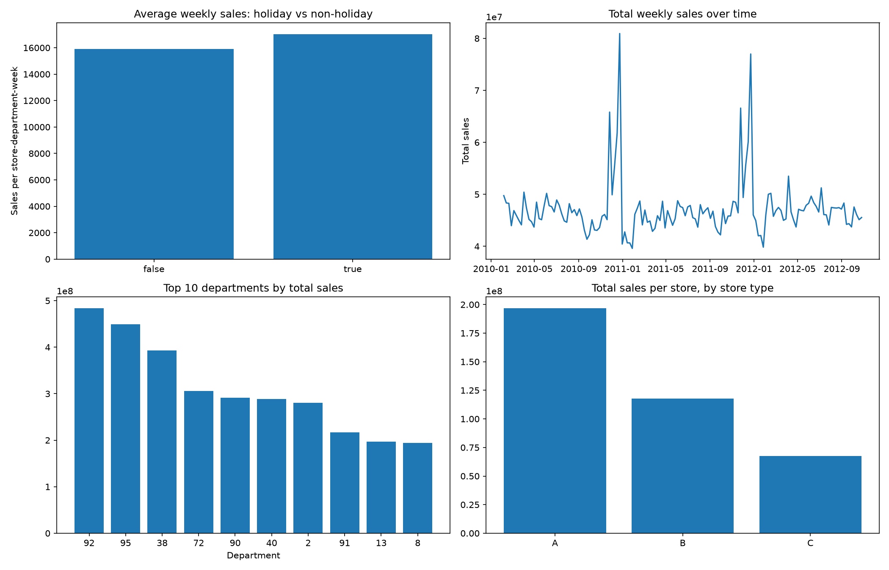

# Walmart Sales Data Pipeline

An end-to-end ELT project that loads Walmart sales data from Amazon S3 into Snowflake, models it into a star schema with dbt, and visualizes the results with Python.

```
S3 (CSV files)
   |  Snowflake storage integration + external stage, COPY INTO
   v
Snowflake  BRONZE   raw tables, every column loaded as text
   |  dbt
   v
Snowflake  SILVER   cleaned and typed staging models
   |  dbt
   v
Snowflake  GOLD     date dimension, store dimension, sales fact table
   |  Python (read-only role)
   v
Charts (matplotlib)
```

## Tech stack

| Layer                      | Tool                                                        |
| -------------------------- | ----------------------------------------------------------- |
| Storage                    | Amazon S3                                                   |
| Warehouse                  | Snowflake                                                   |
| Transformation and testing | dbt (developed in dbt Cloud), `dbt_utils` package           |
| Visualization              | Python, pandas, matplotlib, `snowflake-connector-python`    |
| Authentication             | Key pair authentication for the dbt and visualization users |

## Data

The project uses three CSV files from a Walmart store sales dataset. The files are **not included** in this repository.

| File             | Content                                                                 | Grain                   |
| ---------------- | ----------------------------------------------------------------------- | ----------------------- |
| `department.csv` | Weekly sales per department, holiday flag                               | Store, department, week |
| `fact.csv`       | Temperature, fuel price, markdowns 1-5, CPI, unemployment, holiday flag | Store, week             |
| `stores.csv`     | Store type and size                                                     | Store                   |

## Repository layout

```
.
├── README.md
├── .gitignore
├── dbt_project.yml
├── packages.yml
├── requirements.txt
├── models/
│   ├── walmart_raw/         source definition (schema.yml) + pass-through models: department, fact, stores
│   ├── walmart_silver/      stg_stores, stg_department, stg_fact + schema.yml
│   └── walmart_gold/        walmart_date_dim, walmart_store_dim, walmart_fact_table + schema.yml
├── macros/
│   └── generate_schema_name.sql
├── snowflake/
│   ├── 01_setup.sql                database, schemas, storage integration, stage
│   ├── 02_bronze_load.sql          Bronze tables and COPY INTO
│   └── 03_roles_and_checks.sql     dbt role and user, grants, and the manual checks run during development
├── viz/
│   └── walmart-dashboard.py
└── docs/
    └── walmart_dashboard.png
```

## Data model

### Bronze

Raw tables loaded directly from S3 with `COPY INTO` through an external stage, using `ON_ERROR = 'SKIP_FILE_2%'`.

| Table        | Typing                | Notes                                                                           |
| ------------ | --------------------- | ------------------------------------------------------------------------------- |
| `DEPARTMENT` | All `VARCHAR`         | `skip_header = 1`                                                               |
| `FACT`       | All `VARCHAR`         | `skip_header = 1`. Values such as `NA` stay as text here and become NULL in Silver |
| `STORES`     | All `VARCHAR`         | `skip_header = 1`                                                               |

Every column lands as text so that a bad value cannot reject a row. After each load, `02_bronze_load.sql` runs `VALIDATE` and `COPY_HISTORY` so the loaded row counts can be compared with the CSV files.

### Silver

One staging model per Bronze table. Each model selects explicit columns, renames them, and casts types with `TRY_CAST`, so unparseable values such as `NA` become NULL instead of failing the build. Silver models read Bronze through `source()`, which is declared in `models/walmart_raw/schema.yml`.

The three models in `models/walmart_raw/` (`department`, `fact`, `stores`) copy each Bronze table into a dbt-managed table. Nothing downstream uses these copies (see Limitations).

### Gold

| Model                | One row per                | Key                              |
| -------------------- | -------------------------- | -------------------------------- |
| `walmart_date_dim`   | Week                       | `date_id` (`YYYYMMDD` integer)   |
| `walmart_store_dim`  | Store and department pair  | `store_id`, `dept_id`            |
| `walmart_fact_table` | Store, department and week | `store_id`, `dept_id`, `date_id` |

The fact table starts from department sales and left-joins the store-level measures (temperature, fuel price, CPI, unemployment, markdowns) on store and week, so no sales row is dropped. `date_id` was added to the fact table so it can join to the date dimension. The date dimension is built from the weeks in both source files, and its holiday flag (`isholiday`, stored as text) comes from the store-level file.

All Gold models are built as **SCD Type 1**: incremental models using the `merge` strategy, a `unique_key`, and `merge_update_columns`, so a changed row is overwritten in place and the original `insert_date` is kept. A `NOT EXISTS` filter sends only new or changed rows to the merge, so `update_date` should move only when a value changes.

## Setup

### Prerequisites

- An AWS account with an S3 bucket and an IAM role that Snowflake can assume
- A Snowflake account
- A dbt Cloud account (or dbt Core with a `profiles.yml`; see the note below)
- Python 3.10 or 3.11, and OpenSSL for key generation. The versions pinned in `requirements.txt` (pandas 1.5.2, matplotlib 3.6.2) do not install on Python 3.12 or newer

### 1. Snowflake and S3

1. Upload the three CSV files to your S3 bucket.
2. Open `snowflake/01_setup.sql` and replace the placeholders:
   - `<ACCOUNT_ID>` in the storage integration's role ARN. The role name is `WalmartProjectSnowflakeLoadRole`; change it if yours differs
   - `<BUCKET_NAME>` in the allowed locations and in the stage URL
3. Run the script. It starts with `CREATE OR REPLACE DATABASE WALMART_RAW`, so **running it again deletes the database and everything in it**. Run it once.
4. Run `DESCRIBE INTEGRATION MALMART_S3_INT` (the integration's name is spelled that way in the script) and use the returned IAM user ARN and external ID in the role's trust policy.
5. Run `snowflake/02_bronze_load.sql` to create the Bronze tables and load them. It uses `CREATE OR REPLACE TABLE`, so a re-run reloads from scratch. Check the load output against the CSV row counts.

### 2. Roles and users

`snowflake/03_roles_and_checks.sql` is a working log, not a one-click script. Run it section by section, not top to bottom.

| Section                                | What it does                                                                                            |
| -------------------------------------- | ------------------------------------------------------------------------------------------------------- |
| Start of file                          | Creates `DBT_ROLE` and the `DBT_USER` service user, and grants read on Bronze and write on Silver and Gold |
| Middle                                 | Development checks: date ranges, holiday-flag comparison, and queries against the `DBT_DEV` schema       |
| End                                    | Grants `VIZ_ROLE` read access to the `DBT_DEV` schema                                                    |

The file does **not** create `VIZ_ROLE` or `VIZ_USER`. Create them first:

```sql
USE ROLE ACCOUNTADMIN;
CREATE ROLE IF NOT EXISTS VIZ_ROLE;
GRANT USAGE ON WAREHOUSE COMPUTE_WH TO ROLE VIZ_ROLE;
GRANT USAGE ON DATABASE WALMART_RAW TO ROLE VIZ_ROLE;
CREATE USER IF NOT EXISTS VIZ_USER TYPE = SERVICE DEFAULT_ROLE = VIZ_ROLE DEFAULT_WAREHOUSE = COMPUTE_WH;
GRANT ROLE VIZ_ROLE TO USER VIZ_USER;
```

Do **not** run the `UPDATE WALMART_RAW.BRONZE.FACT ...` statement in the middle of the file; it was a one-off test that changes Bronze data.

| Role       | Purpose                   | Access                                                       |
| ---------- | ------------------------- | ------------------------------------------------------------ |
| `DBT_ROLE` | Used by dbt               | Read Bronze, create objects in Silver, Gold and a dev schema |
| `VIZ_ROLE` | Used by the Python script | Read-only on the schema holding the tables it queries        |

Each role has a service user that authenticates with a key pair. Generate the keys **outside this repository folder** and never commit them:

```bash
openssl genrsa 2048 | openssl pkcs8 -topk8 -v2 aes-256-cbc -inform PEM -out dbt_key.p8
openssl rsa -in dbt_key.p8 -pubout -out dbt_key.pub
```

Attach the public key to the user with `ALTER USER <user> SET RSA_PUBLIC_KEY = '...'`, using only the text between the `BEGIN` and `END` lines. Repeat with a separate key pair for `VIZ_USER`.

### 3. dbt

1. Create a dbt project connected to Snowflake with key pair credentials (database `WALMART_RAW`, role `DBT_ROLE`) and add this repository's files.
2. Install packages and build:

```bash
dbt deps
dbt build --full-refresh   # first run, to create the incremental tables
dbt build                  # later runs
```

The `generate_schema_name` macro keeps all objects in the developer's schema (`DBT_DEV` in this project) outside production, and routes models to `SILVER` and `GOLD` when the target is named `prod`.

**dbt Core:** this project was developed in dbt Cloud, so no `profiles.yml` is included. To use dbt Core, create a `profiles.yml` for Snowflake with key pair authentication and read the secrets from environment variables. Never commit it.

### 4. Visualization

```bash
python -m venv .venv
source .venv/bin/activate            # Windows: .venv\Scripts\activate
pip install -r requirements.txt
pip install "snowflake-connector-python[pandas]"   # not listed in requirements.txt

export SNOWFLAKE_ACCOUNT="<org>-<account>"
export SNOWFLAKE_PRIVATE_KEY_PATH="/path/to/viz_key.p8"
export SNOWFLAKE_PRIVATE_KEY_PASSPHRASE="<passphrase>"

python viz/walmart-dashboard.py
```

The script connects as `VIZ_USER` with role `VIZ_ROLE`, and saves `walmart_dashboard.png` in the folder you run it from (copy it to `docs/` to update the image below) and opens a chart window. It reads the schema set in the `schema=` argument inside `run_query` (currently `DBT_DEV`); change that to `GOLD` after a production deployment.

## Design decisions

| Decision                                  | Reason                                                                                                                      |
| ----------------------------------------- | --------------------------------------------------------------------------------------------------------------------------- |
| All Bronze columns loaded as text         | Raw landing should not reject rows. Type problems surface in Silver, where `TRY_CAST` turns them into NULL and `not_null` tests flag the columns that matter |
| `TRY_CAST` in Silver for `NA` values      | Missing markdowns and similar become real NULLs without a load-time setting                                                 |
| One Silver model per Bronze table         | Each source is cleaned in one place, and joining is left to Gold                                                            |
| `date_id` as a `YYYYMMDD` integer         | Readable, deterministic, and no hashing needed for a calendar key                                                           |
| Left join from department sales           | Sales rows are the facts and should not be dropped by a missing store-level row                                             |
| Incremental merge for SCD1                | Overwrites changed rows in place and keeps the original insert timestamp                                                    |
| Separate roles for dbt and visualization  | Least privilege: the visualization user is read-only                                                                        |
| Key pair authentication                   | Service users have no password or MFA prompt, and keys can be rotated                                                       |

## Testing and data quality

dbt tests (run by `dbt build`):

| Model                | Tests                                                                                               |
| -------------------- | --------------------------------------------------------------------------------------------------- |
| `stg_stores`         | `unique` and `not_null` on `store_id`; `not_null` on `store_size` and `store_type`                  |
| `stg_department`     | `not_null` on all five columns                                                                      |
| `stg_fact`           | `not_null` on `store_id`, `weekly_date`, `average_temperature` and `is_holiday`                     |
| `walmart_date_dim`   | `unique` and `not_null` on `date_id`                                                                |
| `walmart_store_dim`  | `not_null` on both key columns; `dbt_utils.unique_combination_of_columns` on `store_id`, `dept_id`  |
| `walmart_fact_table` | `not_null` on `store_id` and `dept_id`; unique combination of `store_id`, `dept_id`, `date_id`      |

Manual checks, run during development (queries in `snowflake/03_roles_and_checks.sql`, not automated):

- Earliest and latest week in each of the two source files
- A comparison of the holiday flag between `stg_fact` and `stg_department`
- A spot check of one fact row's `insert_date` and `update_date`

There are no foreign-key tests from the fact table to the dimensions and no row-count test between Silver and Gold.

## Results



The dashboard contains four views:

- Average weekly sales per store-department-week, holiday versus non-holiday weeks (about 17,000 against about 15,900)
- Total weekly sales over time, with peaks in late November and December of 2010 and 2011
- The top 10 departments by total sales
- The average of total sales per store, by store type (A, B and C)

The holiday comparison uses the source file's holiday flag. Check which weeks it marks before reading the difference as a holiday effect, because a very large pre-Christmas sales week may not be flagged.

## Limitations

| Limitation                                         | Detail                                                                                                                                                                                                                                             |
| -------------------------------------------------- | -------------------------------------------------------------------------------------------------------------------------------------------------------------------------------------------------------------------------------------------------- |
| Production deployment not run                      | Models were built and tested in a dev schema (`DBT_DEV`), and the dashboard reads from it. The macro that routes models to `SILVER` and `GOLD` exists but was not exercised in a deployed job                                                      |
| Store-level measures repeat per department         | Temperature, fuel price, CPI, unemployment and markdowns repeat on every department row. Summing them gives wrong results, and averaging across department rows weights each store by its number of departments. Aggregate to store and week first |
| SCD1 keeps no history                              | Changed values are overwritten. `vrsn_start_date` and `vrsn_end_date` are placeholders, and rows deleted at the source are not removed from Gold                                                                                                   |
| SCD1 update path not confirmed                     | The manual test that changed a Bronze `CPI` value updated no rows (the date filter did not match), so the overwrite-in-place behavior has not been demonstrated end to end                                                                         |
| Date dimension extends past the last sales week    | The store-level file covers more weeks than the department sales file (through July 2013, against October 2012), so some dates have no sales                                                                                                       |
| Store dimension repeats store attributes           | Store type and size repeat for every department, as required by the assignment's schema                                                                                                                                                            |
| Unused `walmart_raw` models                        | The three pass-through models copy Bronze into extra tables that nothing reads. Only the source definition in `models/walmart_raw/schema.yml` is used                                                                                              |
| Manual loading                                     | `COPY INTO` runs by hand, with no Snowpipe, scheduling or orchestration                                                                                                                                                                            |
| Setup scripts are not re-runnable                  | `01_setup.sql` uses `CREATE OR REPLACE DATABASE`, which deletes existing data. `03_roles_and_checks.sql` is a log to run in sections, and it does not create `VIZ_ROLE` or `VIZ_USER`                                                               |
| Broad setup role                                   | The setup scripts use `ACCOUNTADMIN`, which is acceptable for a personal project but not for a shared environment                                                                                                                                  |
| Python setup                                       | `requirements.txt` pins old versions that need Python 3.10 or 3.11 and leaves out the Snowflake connector                                                                                                                                          |
| Limited testing                                    | Tests cover keys, uniqueness and non-null checks, and the Python code has no automated tests                                                                                                                                                       |
| Incremental comparison scans the target            | The `NOT EXISTS` filter reads the whole target table each run, which is fine at this size but would not scale to very large tables                                                                                                                 |
| No CI                                              | There are no automated checks on pull requests                                                                                                                                                                                                     |

## Possible improvements

- Run the production deployment and point the dashboard at `GOLD`
- Add foreign-key (`relationships`) tests and a row-count test between Silver and Gold
- Split `03_roles_and_checks.sql` into a runnable roles script (including `VIZ_ROLE`) and a separate checks file
- Use `IF NOT EXISTS` in the setup script, and remove the unused `walmart_raw` models
- Add a scheduled dbt job and automate loading with Snowpipe
- Add dbt CI on pull requests
- Track history with dbt snapshots (SCD2) where it is needed
- Add source freshness checks and more business-rule tests

## Author

`Eze Amadi` | `https://www.linkedin.com/in/ezeamadi/`
